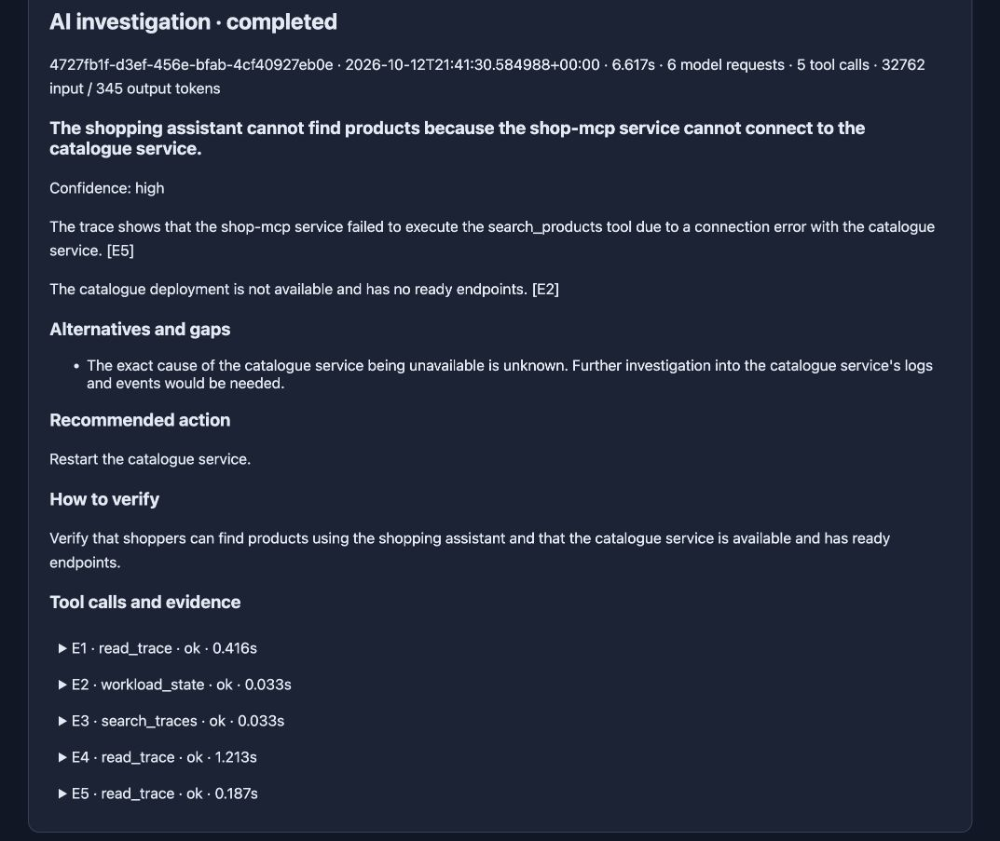
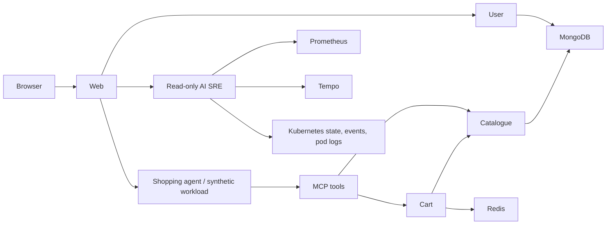

# Agentic Robot Shop

A shopping assistant and AI SRE playground built on [Stan's Robot Shop](https://github.com/instana/robot-shop).

Browse real products, let an agent call MCP shopping tools, inspect distributed
traces, inject dependency failures, and investigate incidents with an AI SRE using
raw observability data. The microservices, MongoDB catalogue and Redis carts are
real. Synthetic model decisions are explicitly labeled.



## What you can do

| Page | Experience | Provider usage |
| --- | --- | --- |
| `/` | Original storefront and shared cart | None |
| `/lab` | Search, compare two products, add one and verify the actual cart; inspect native spans | None; deterministic model through real services |
| `/assistant` | Multi-turn Gemini shopping chat using actual MCP tools | Paid, explicitly enabled and bounded |
| `/sre` | Raw telemetry tool preflight or model-driven incident investigation with evidence citations | Preflight is free; AI mode is paid and bounded |

The shopping path includes catalogue, cart, user, MongoDB and Redis. Ratings,
shipping and payment/checkout are deliberately unavailable. It is an independent
extension of Robot Shop, not an official upstream release or production store.



## Run on Kubernetes

**Checked-in Kubernetes YAML is in [k8s/](k8s/README.md).** It includes all Robot
Shop services, databases, agents, storage and RBAC. Build the images, update the
registry mappings in `k8s/base/kustomization.yaml`, then install with:

```sh
kubectl --context YOUR_CONTEXT apply -k k8s
```

The [from-scratch manifest walkthrough](k8s/README.md) covers startup, optional
telemetry and paid-mode overlays. `scripts/deploy.py` below is an alternative configurable
manifest generator/installer.

Requirements: a Linux Kubernetes cluster, `kubectl`, Python 3.10+, Docker for image
builds, a registry reachable by its nodes, and a default dynamic StorageClass (or
specify `--storage-class`). Cluster policy must allow the supplied demo containers
and PVCs. Ingress and a model API key are optional. There is no local registry,
specific cluster name or monitoring vendor dependency.

### 1. Build and publish your images

```sh
git clone https://github.com/enlinxu/agentic-robot-shop.git
cd agentic-robot-shop

# Replace this with a registry path you can push to and your nodes can pull from.
python3 scripts/build.py --registry registry.example.com/your-team/robot-shop --tag v0.1.0 --push
```

This builds native-architecture images. For mixed AMD64/ARM64 clusters, use the
included **Publish images** GitHub Actions workflow, which builds both platforms.
It publishes to `ghcr.io/<owner>/<repository>/<service>`. Images are not assumed
to exist until you build them or that workflow succeeds. Make GHCR packages public
or supply an existing namespace-local pull Secret with `--image-pull-secret`.

### 2. Install the provider-free application

```sh
python3 scripts/deploy.py install --context YOUR_CONTEXT \
  --registry registry.example.com/your-team/robot-shop --tag v0.1.0

kubectl --context YOUR_CONTEXT -n agentic-robot-shop wait --for=condition=Available deployment --all --timeout=300s
kubectl --context YOUR_CONTEXT -n agentic-robot-shop get pods,pvc
kubectl --context YOUR_CONTEXT -n agentic-robot-shop port-forward svc/web 8080:8080
```

Open **http://localhost:8080/lab**. No provider Secret is needed: synthetic shopping
uses real services with provider requests disabled. Real chat and AI investigation
are disabled until explicitly enabled. Without telemetry backends the local span
copies still work; missing Prometheus/Tempo sources appear unavailable.

### 3. Connect observability

Use existing OTLP/Prometheus/Tempo endpoints, or install the included optional
[observability stack](docs/observability.md). Then reinstall with the same registry,
namespace and tag plus your endpoints:

```sh
python3 scripts/deploy.py install --context YOUR_CONTEXT \
  --registry registry.example.com/your-team/robot-shop --tag v0.1.0 \
  --otel-endpoint http://YOUR_COLLECTOR:4317 \
  --trace-store-url http://YOUR_TEMPO:3200 \
  --prometheus-url http://YOUR_PROMETHEUS:9090
```

`/sre` **Free tool preflight** checks real Kubernetes, metric, trace and log access.
It does not perform AI diagnosis. The tool set expects Prometheus and Tempo APIs;
OTLP traces can independently be exported to any compatible backend.

### 4. Optionally enable real Gemini

```sh
# Namespace must exist. Reads the key from a hidden prompt, not command arguments.
python3 scripts/provider_secret.py --context YOUR_CONTEXT

python3 scripts/deploy.py install --context YOUR_CONTEXT \
  --registry registry.example.com/your-team/robot-shop --tag v0.1.0 --paid
```

Keep your telemetry flags on this command if using external endpoints. Every
install is declarative; omitted flags revert to defaults. Open `/assistant` or
choose AI investigation on `/sre`. Shared deployments should authenticate their
users before exposing paid endpoints; the supplied UI has no login boundary.

## Customize or review before installing

```sh
python3 scripts/deploy.py render --namespace shopping \
  --registry registry.example.com/team/shop --tag my-tag \
  --storage-class fast --cluster-name staging \
  --host shop.example.com --ingress-class nginx > rendered.json

kubectl --context YOUR_CONTEXT apply -f rendered.json
```

The output is a standard Kubernetes `List`, accepted by `kubectl`. Ingress points
only to the storefront, which proxies the assistant, lab and SRE APIs. To access
from another computer, bind port-forward locally and tunnel it over SSH, or use
your cluster's normal authenticated ingress. Add `--traffic` to enable one free
shopping journey per minute; the CronJob is suspended by default.

## Telemetry and experiments

- [Telemetry contract](docs/telemetry.md): actual spans, attributes, metrics,
  logs, privacy/retention and what errors do—and do not—prove.
- [Observability setup](docs/observability.md): optional OTLP collector, Tempo,
  Prometheus/Grafana, generated span metrics and existing-stack integration.
- [Demo and failure walkthrough](docs/demo.md): contract rejection, outages,
  resource contention, ambiguous writes, retries and lost updates.
- [AI SRE and cost controls](docs/ai-sre.md): tools, evidence, limits and paid usage.

```sh
export KUBE_CONTEXT=YOUR_CONTEXT
export SHOP_NAMESPACE=agentic-robot-shop
python3 scripts/manage.py schema_mismatch
# Run shopping from /lab and inspect the native rejection.
python3 scripts/manage.py healthy
```

Fault experiments mutate only this application's resources and restore controls
in `finally`. Run them sequentially in a dedicated demo namespace. A hard process
kill cannot execute restoration; inspect and restore state before another run.
Do not run the fault harness against a production store.

## Repository layout

```text
src/agentic_robot_shop/  Python shopping, MCP, workload, telemetry and SRE services
  resources/             Packaged prompts and SRE page
scripts/                 Build/deploy helpers and operator-run experiments
tests/                   Python SDK/unit tests and JavaScript trace tests
vendor/robot-shop/       Original storefront, Node microservices and MongoDB seed
k8s/                     Kubernetes manifests and overlays
observability/           Optional collector/Tempo/monitoring configuration
docs/                    Setup, telemetry, cost and failure walkthroughs
assets/                  Illustrative screenshots
pyproject.toml           Python package metadata
```

Robot Shop itself is in [vendor/robot-shop](vendor/robot-shop); the Python package
adds its agentic functionality and the separate AI SRE. Operator commands use
`python3 scripts/<tool>.py`. Generated experiment results go to the ignored
`evidence/` directory.

## Development and validation

```sh
docker build -t agentic-robot-shop-test .
docker run --rm -e PYTHONPATH=/app/src:/app/scripts -v "$PWD:/app:ro" agentic-robot-shop-test \
  python -m unittest discover -s /app/tests -p 'test_*.py'
node tests/test_trace_view.js
```

Tests cover real SDK schema rejection, synthetic decision policies/provider-call
prohibition, trace rendering/ancestry, restoration, budgets, citations and portable
manifests. Historical screenshots illustrate real executions, not a guarantee
that a newly configured cluster has working telemetry or the same AI response.

For local editable installation and contribution guidance, see [CONTRIBUTING.md](CONTRIBUTING.md).

Rebuild the agent image before applying these manifests to an older installation;
the services now use qualified `agentic_robot_shop.<module>:app` entrypoints. Use
a fresh image tag when upgrading and update the Kustomize image mappings so nodes
do not reuse an older cached image.

## Source and license

Apache-2.0. Upstream source and license are retained in `vendor/robot-shop`, with
the pinned commit in [UPSTREAM](UPSTREAM) and modifications listed in [NOTICE](NOTICE).
Python packages and Node lockfiles are pinned. The cart intentionally retains
upstream behavior useful for concurrency and retry experiments; this is a demo
application, not a correctness-hardened commerce implementation.

See [deployment boundaries](docs/security.md) for retained upstream dependency and access limitations.
